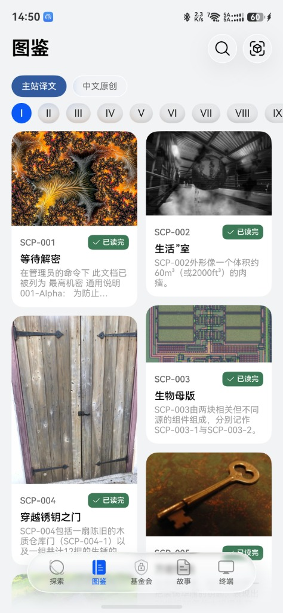
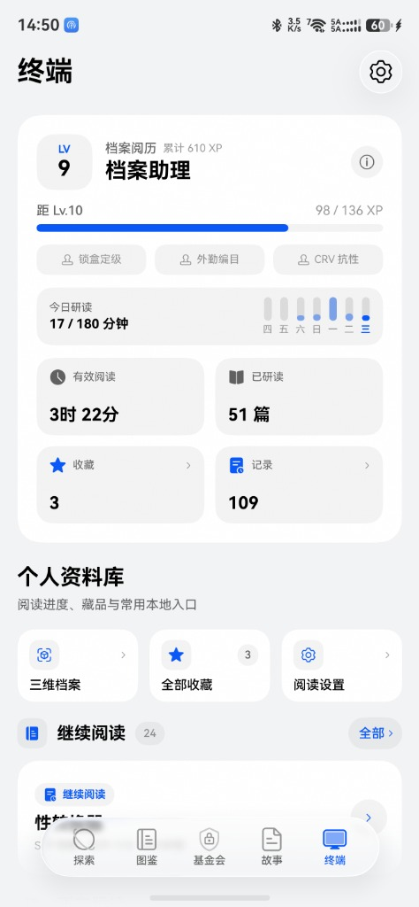

<div align="center">
  
  <h1>格异录 · Anomicon</h1>
  <p>一款为 HarmonyOS 多端设备（手机、折叠屏、平板与二合一）打造的<br>非官方 SCP 中文阅读、探索与三维档案应用。</p>
</div>

> [!IMPORTANT]
> 格异录是非官方社区项目，与 SCP Wiki 不存在隶属、合作或认可关系。应用展示的 SCP 内容及相关素材归各自创作者所有。

## 功能

- **探索**：汇集高评分原创、近期更新、搞笑条目与每日推荐，宽屏设备自动切换为双栏排布。
- **图鉴与故事**：支持浏览 Series I–X 完整 SCP 档案（含已阅进度与 3D 档案角标）及故事目录；支持独立跨系列搜索（「全部系列」检索、随机发现与搜索历史）与故事首字母索引筛选。
- **原生阅读与研读工作台**：将 Wiki 页面解析为 ArkUI 虚拟化原生阅读视图，支持正文字号/行距调节、全屏图片预览、阅读进度状态栏与位置自动恢复；窄屏提供原地自适应沉浸光感脚注半模态，大屏提供右侧可折叠「研读侧栏」，集中翻阅脚注与关联故事并联动正文自动跳转高亮。
- **多端与大屏适配**：完整适配手机、折叠屏、平板与二合一设备；首页全屏充分展示多栏内容，进入二级页面自动切换动态主从分栏（左栏 `380vp` 主视图 + 右栏详情），支持就地切换条目、详情页「全屏阅读 / 全屏展开」及返回自动恢复分栏，并将长文与设置阅读宽度约束在舒适的 `740vp`。
- **个人资料库与终端**：在本地保存收藏、阅读历史、进度与有效阅读时长统计，生成研究档案并提供基金会手册入口。
- **离线、弱网与性能**：接入系统网络质量监测与并发自适应调度、HTTP 连接复用与多级本地缓存（RDB / 文件 / 图片池），将 HTML 与目录解析迁至 `TaskPool` 后台线程，弱网或离线时优先呈现已缓存内容并静默重验更新。
- **三维档案**：基于 ArkGraphics3D 展示经过整理的 GLB 模型（当前内置 4 项经典档案、另含 6 项按需下载档案），呈现项目等级角标、来源与许可说明弹窗；大屏展开为 60%/40% 水平三维工作台，按需下载资源在使用前严格校验字节长度与 SHA-256。
- **HarmonyOS 原生界面**：采用 ArkUI（`@ComponentV2`）、HDS 导航与浮动底栏胶囊设计，适配深浅色主题、可开关的系统沉浸光感材质与触感反馈。

## 应用展示

格异录把内容发现、系列浏览、原生阅读与三维查看串联在同一套交互中；下方为手机端竖屏界面概览，在平板与展开态折叠屏上会进一步扩展为多栏排布与主从分栏工作台。

<table>
  <tr>
    <td width="50%" align="center">
      
      <br><strong>探索</strong><br><sub>从推荐与内容集合中发现感兴趣的条目</sub>
    </td>
    <td width="50%" align="center">
      
      <br><strong>图鉴</strong><br><sub>按系列浏览、搜索并识别含三维档案的项目</sub>
    </td>
  </tr>
  <tr>
    <td width="50%" align="center">
      
      <br><strong>故事</strong><br><sub>按标题或路径搜索，并通过字母索引快速筛选</sub>
    </td>
    <td width="50%" align="center">
      
      <br><strong>终端</strong><br><sub>集中查看阅读等级、统计和保存在本地的个人资料</sub>
    </td>
  </tr>
  <tr>
    <td width="50%" align="center">
      
      <br><strong>三维档案馆</strong><br><sub>统一管理随应用提供或按需下载的模型资源</sub>
    </td>
    <td width="50%" align="center">
      
      <br><strong>三维档案</strong><br><sub>查看模型、档案说明、资源来源与版本信息</sub>
    </td>
  </tr>
</table>

## 下载与安装

请前往项目 Releases 页面查看最新版本与发布说明。当前应用面向 HarmonyOS 7.0（API 26）的手机（`phone`）、平板（`tablet`）、二合一（`2in1`）及折叠屏设备构建。

> [!NOTE]
> GitHub Releases 附带的 `.hap` 构建产物为自动化流水线生成的**未签名安装包**（unsigned HAP），无法直接安装到零售真机。如需安装测试，请使用 DevEco Studio 配合个人/团队调试签名或正式签名重新签名打包，或克隆仓库从源码构建安装。请只从本项目发布页获取文件并核对发布说明。

### 本地开发与构建检查

构建或调试源码需安装支持 HarmonyOS SDK 7.0.0（API 26）的 DevEco Studio（含 `ohpm` 与 `hvigorw`）以及 Node.js（用于架构约束检查）：

```sh
# 1. 安装 OHPM 依赖
ohpm install --all

# 2. 检查模块依赖方向与环依赖（products -> features -> common）
node scripts/architecture-check.mjs --strict

# 3. 运行基础层与响应式布局单元测试
hvigorw test -p module=anomiconbasic@default -p buildMode=test --no-daemon

# 4. 构建 Debug HAP
hvigorw assembleHap -p module=phone@default -p product=default -p buildMode=debug --no-daemon
```

## 技术实现

- HarmonyOS SDK 7.0.0（API 26）
- ArkTS / ArkUI（`@ComponentV2` 状态管理与多断点响应式布局策略）
- HDS（`@kit.UIDesignKit`）导航栏与浮动底栏组件
- ArkData RDB 与 Preferences 本地持久化
- Remote Communication Kit、Network Boost Kit（网络质量与切换感知）、FAST Kit 与 ArkTS TaskPool
- ArkGraphics3D、ArkWeb、Image Kit、Crypto Architecture Kit 与 Sensor Service Kit
- Hvigor / OHPM

项目采用 `products → features → common` 的多模块单向依赖架构，并在各功能模块内清晰划分领域、应用、数据、界面与装配层：

```text
Anomicon/
├── AppScope/                    # 应用级配置、版本与图标
├── common/anomiconbasic/        # 响应式布局策略、导航样式、基础组件、平台端口与缓存
├── features/
│   ├── article/                 # 文章获取、TaskPool 解析、虚拟化正文渲染与研读工作台
│   ├── archive3d/               # 三维资源清单、按需下载、SHA-256 校验与领域逻辑
│   ├── catalog/                 # SCP 图鉴、故事目录、跨系列搜索与预览图
│   ├── explore/                 # 推荐流、榜单与近期更新集合
│   ├── library/                 # 收藏、阅读历史、进度与有效阅读研究活动
│   ├── settings/                # 主题、材质、字号/行距与信息页面
│   └── terminal/                # 个人资料库与研究档案终端
├── products/phone/              # 主应用 HAP（适配 phone / tablet / 2in1）、路由与依赖装配
├── scripts/                     # 架构依赖方向检查与发布元数据脚本
└── tools/archive3d/             # 三维资源批量审查与 GLB 预处理脚本
```

## 数据与权限

应用从 [SCP 基金会中文 Wiki](https://scp-wiki-cn.wikidot.com/) 获取公开页面，并在设备上保存目录、文章和图片缓存，以及个人收藏、设置与阅读记录。4 项经典三维模型随应用内置提供，其余 6 项按需模型从资源清单锁定的上游提交通过 HTTPS 下载，并在加载前严格校验文件字节数和 SHA-256。

应用在 [`module.json5`](products/phone/src/main/module.json5) 中申请了以下权限：

- `ohos.permission.INTERNET`：加载 Wiki 页面、条目图片与按需三维档案模型。
- `ohos.permission.GET_NETWORK_INFO`：配合网络质量感知调整并发调度与缓存重验策略。
- `ohos.permission.VIBRATE`：提供系统触感反馈（可在设置中随时关闭）。

## 许可与署名

仓库中的应用源代码使用 [Apache License 2.0](LICENSE) 许可。

SCP 相关文字、概念和衍生视觉/三维资源不适用 Apache License 2.0，它们依据各自的上游声明及 [Creative Commons Attribution-ShareAlike 3.0](https://creativecommons.org/licenses/by-sa/3.0/) 使用。三维模型的详细作者、固定上游提交版本、许可与修改说明见 [`scp-model-attribution.txt`](products/phone/src/main/resources/rawfile/licenses/scp-model-attribution.txt)。分发衍生版本前，请保留完整署名并复核 [SCP 许可指南](https://scp-foundation.net/licensing-guide)。
