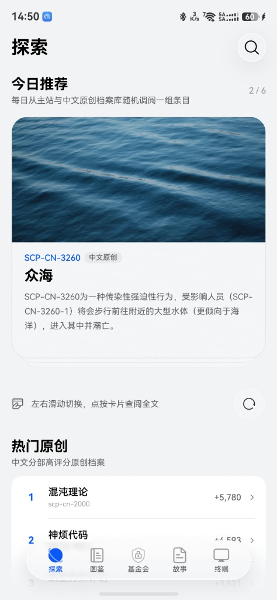
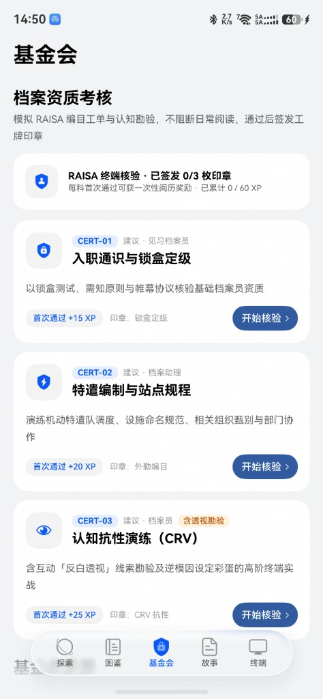
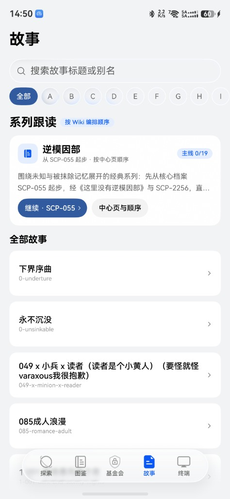
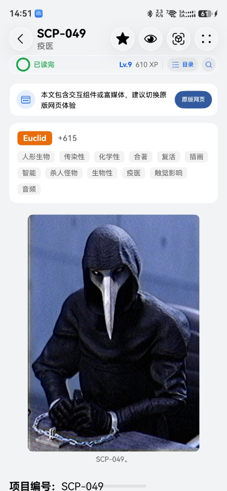
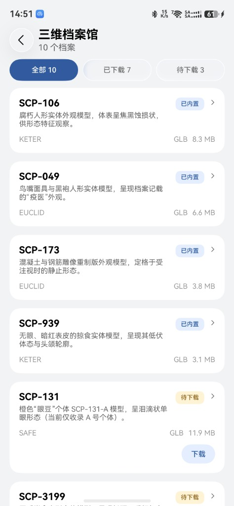
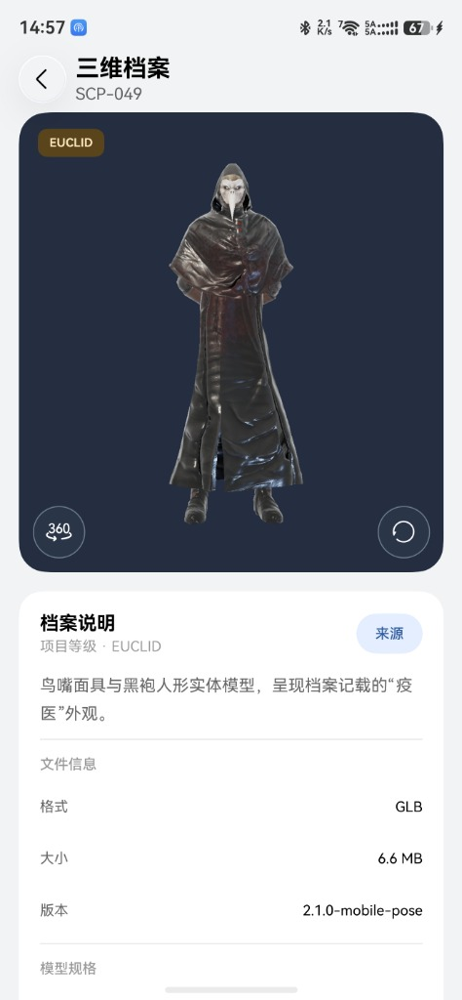
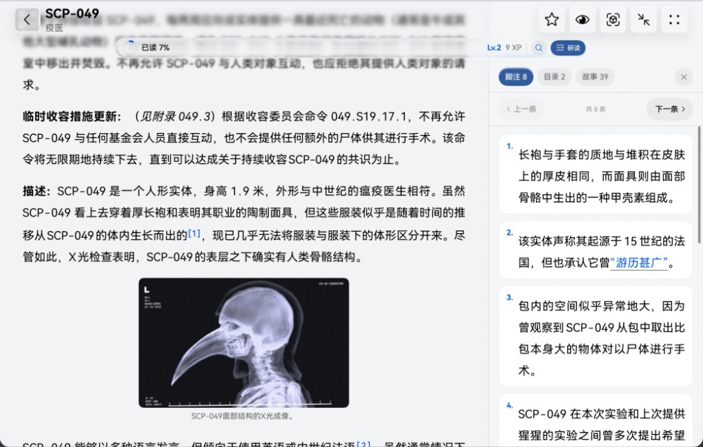

<div align="center">
  
  <h1>格异录 · Anomicon</h1>
  <p>面向 HarmonyOS 多端设备（手机、折叠屏、平板、二合一）打造的<br>非官方 SCP 中文阅读、探索与三维档案应用</p>
  <p>
    <sub>HarmonyOS 7.0 (API 26) · ArkTS / ArkUI (@ComponentV2) · HDS · ArkGraphics3D</sub>
  </p>
</div>

> [!IMPORTANT]
> 格异录是非官方社区项目，与 SCP Wiki 不存在隶属、合作或认可关系。应用内呈现的 SCP 条目文本、图片及相关三维模型素材均归各自创作者所有。

---

## 界面预览

> 各展示图说明与拍摄规范见 [`docs/images/README.md`](docs/images/README.md)。

<table>
  <tr>
    <td width="33%" align="center">
      
      <br><strong>探索</strong><br><sub>每日推荐卡组、高评分原创、近期更新与搞笑条目</sub>
    </td>
    <td width="33%" align="center">
      
      <br><strong>图鉴</strong><br><sub>主站译文与中文原创分枝切换、系列浏览与三维标识</sub>
    </td>
    <td width="33%" align="center">
      
      <br><strong>基金会</strong><br><sub>基金会设定手册、RAISA 资质考核与工单入口</sub>
    </td>
  </tr>
  <tr>
    <td width="33%" align="center">
      
      <br><strong>故事</strong><br><sub>标题/路径搜索、首字母索引筛选与「系列跟读」</sub>
    </td>
    <td width="33%" align="center">
      
      <br><strong>终端</strong><br><sub>研究员档案工牌、资质印章与本地个人资料库</sub>
    </td>
    <td width="33%" align="center">
      
      <br><strong>原生阅读器</strong><br><sub>章节目录、文内查找、原版网页切换与文末上拉标记已读</sub>
    </td>
  </tr>
  <tr>
    <td width="33%" align="center">
      
      <br><strong>三维档案馆</strong><br><sub>内置与按需下载模型资源管理与校验状态</sub>
    </td>
    <td width="33%" align="center">
      
      <br><strong>三维档案详情</strong><br><sub>舞台手势旋转缩放、360° 自动旋转、复位与署名信息</sub>
    </td>
    <td width="33%" align="center">
      
      <br><strong>宽屏研读侧栏</strong><br><sub>平板 / 折叠屏 / 二合一自适应双栏与脚注目录侧栏</sub>
    </td>
  </tr>
</table>

---

## 核心功能

### 五大核心页签

- **探索**：汇集每日推荐卡组（支持翻阅与换一批）、高评分原创、近期更新与搞笑条目；宽屏下自动切换为双栏排布。
- **图鉴**：支持**主站译文（Series I–X）**与**中文原创（CN-I–CN-V）**分枝切换，提供跨系列搜索（支持 `173`、`CN-2000` 等编号缩写及 Wiki 链接直达）、搜索历史、随机发现与三维档案标识；标题栏集成「搜索」与「三维档案馆」入口。
- **基金会**：提供基金会设定手册（项目等级、异常等级、安保权限、机动特遣队、部门、设施、相关组织与历史沿革等）与 **RAISA 资质考核**（含 CRV 认知阻抗测试等题库），通过考核可获取工牌印章与研究经验（XP）；内置 **RAISA 终端运维工单**入口。
- **故事**：支持按标题或路径搜索、按路径首字母索引快速筛选，并提供「系列跟读」（如《逆模因部》连续阅读进度追踪）。
- **终端**：集中展示研究员档案工牌（研究等级、有效阅读时长、资质印章）与本地个人资料库（全部收藏、阅读历史、「继续阅读」续读列表、离线副本管理），并提供三维档案馆与设置的快捷入口。

### 双模阅读与离线保存

- **原生视图 / 原版网页切换**：
  - **原生视图**：通过 TaskPool 后台解析 HTML 并以虚拟化列表渲染，支持章节目录、文内查找（命中折叠块或标签页时自动展开并定位）、字号/行距/对齐方式调节，以及自动记忆阅读位置。
  - **全屏配图预览**：支持双指捏合与双击围绕触点放大、放大后拖动查看细节、再次双击还原，以及多图左右翻页。
  - **研读辅助与已读交互**：窄屏在正文弹出脚注，宽屏（容器宽度 `>= 680vp`，`>= 960vp` 自动展开）在研读侧栏同步展示脚注与关联故事；滑至文末后继续上拉并松手即可标记或取消已读。
- **离线阅读与弱网缓存**：可从正文菜单将文章及配图保存至本地 RDB 离线库，在终端「离线保存」中随时打开或手动更新副本；弱网环境下优先呈现可用缓存。

### 三维档案观测

- **分层资源交付**：随应用内置 **4 个**经典模型（SCP-049、SCP-106、SCP-173、SCP-939），另有 **6 个**模型（SCP-079、SCP-131-A、SCP-178、SCP-650、SCP-686、SCP-3199）支持按需 HTTPS 下载至应用私有缓存，加载前严格校验字节数、GLB 2.0 文件头与 SHA-256。
- **交互舞台与档案信息**：支持单指拖拽旋转、双指缩放、舞台左下角 `360°` 自动旋转开关与右下角视角复位按钮，并展示项目等级、来源说明、预处理备注与 CC BY-SA 3.0 署名信息；宽屏（`>= 800vp`）采用双栏工作台布局。

### RAISA 运维工单

- 可从设置、基金会页签或正文「更多 → 上报档案异常」打开。
- 支持选择问题分类、附带可选诊断快照，并上传最多 **3 个**附件（截图、日志、文本或 PDF；单文件上限 `2 MiB`，合计上限 `5 MiB`，大图按需自动缩放压缩），通过中转服务校验限流后自动在 GitHub Issues 创建工单。

### 多端响应式与沉浸体验

- **断点自适应布局**：基于 `sm (< 600vp)`、`md (600–839vp)`、`lg (840–1199vp)`、`xl (>= 1200vp)` 断点动态调整页边距与多列栅格；窗口宽度 `>= 840vp` 时主导航自动切换为 `HdsNavigation` Split 分栏模式，支持详情页全屏展开阅读。
- **主题与系统材质**：支持浅色、深色与跟随系统主题，可在设置中开关系统沉浸光感材质（`hdsMaterial`）与触感反馈。

---

## 下载与安装

请前往项目 [Releases](https://github.com/Suixin04/Anomicon/releases) 页面获取最新版本与发布说明，或克隆仓库后使用 **DevEco Studio（HarmonyOS SDK 7.0.0 / API 26）** 打开并构建运行。应用面向 HarmonyOS 7.0（API 26）的手机（`phone`）、平板（`tablet`）、二合一（`2in1`）及折叠屏设备构建。

> [!NOTE]
> GitHub Releases 附带的 `.hap` 构建产物为自动化流水线生成的**未签名安装包（unsigned HAP）**，真机安装需自行签名或配合相应安装方式。请仅从本项目发布页获取文件并核对发布说明。

---

## 技术实现与架构

### 技术栈

- **基础框架**：HarmonyOS SDK 7.0.0（API 26）、ArkTS / ArkUI（`@ComponentV2` 状态管理 + 多断点响应式布局策略）
- **界面与动效**：HDS（`@kit.UIDesignKit`）导航栏与浮动底栏、系统沉浸光感材质（`hdsMaterial`）
- **数据与持久化**：ArkData RDB（文章缓存、离线副本）与 Preferences（设置与状态）
- **网络与并发**：Remote Communication Kit（RCP）、Network Boost Kit（网络质量与切换感知）、FAST Kit 与 ArkTS TaskPool
- **图形与多媒体**：ArkGraphics3D（GLB 2.0 渲染）、ArkWeb、Image Kit、Crypto Architecture Kit（SHA-256 校验）与 Sensor Service Kit
- **工程构建**：Hvigor / OHPM

### 模块结构

项目遵循 HarmonyOS `products -> features -> common` 分层架构：`products/phone` 负责应用入口、路由与依赖装配，`features/*` 内部按 `domain / application / data / presentation / composition` 划分边界，由静态架构检查脚本保障依赖方向。

```text
Anomicon/
├── AppScope/                    # 应用级配置（com.suixin.anomicon）、版本信息与图标
├── common/anomiconbasic/        # 响应式断点策略、HDS 导航样式、基础组件、平台端口与缓存工具
├── features/
│   ├── article/                 # 文章获取、TaskPool 解析、虚拟化正文渲染、研读侧栏与离线存储
│   ├── archive3d/               # 三维资源清单、按需下载、SHA-256 校验与领域模型
│   ├── catalog/                 # 主站/CN 系列图鉴、故事目录、跨系列搜索与预览图
│   ├── explore/                 # 每日推荐卡组、高评分原创、近期更新与搞笑条目集合
│   ├── library/                 # 收藏、阅读历史、进度、系列跟读、资质考核与 RAISA 工单领域逻辑
│   ├── settings/                # 主题、沉浸材质、排版调节、存储清理与关于/许可页面
│   └── terminal/                # 终端主页、基金会设定手册、资质考核与 RAISA 工单界面
├── products/phone/              # 主应用 HAP（phone / tablet / 2in1）、路由表、启动协调与依赖装配
├── scripts/                     # 主机单元测试、架构依赖检查、阅读交互检查与发布元数据校验
└── tools/
    ├── archive3d/               # 三维资源批量审查与 GLB 预处理脚本
    └── raisa-relay/             # 无第三方依赖的 RAISA 工单中转服务（Node.js 20+）
```

---

## 开发与校验

配置 DevEco Studio 的 API 26 SDK、`ohpm` 与 `hvigorw` 后，可在仓库根目录执行以下脚本：

```bash
# 安装全部模块依赖
ohpm install --all

# 运行主机单元测试（读取各模块 Hypium 逐例报告）
node scripts/test-host.mjs
node scripts/test-host.mjs catalog article   # 仅运行指定模块

# 静态检查多模块边界与分层依赖方向
node scripts/architecture-check.mjs --strict

# 阅读器交互回归测试（需先构建 debug HAP 并设置 DEVECO_SDK_HOME）
node scripts/test-reader-interactions.mjs
```

---

## 数据、权限与隐私

- **内容获取与本地存储**：应用从 [SCP 基金会中文 Wiki](https://scp-wiki-cn.wikidot.com/) 获取公开页面。目录、文章和图片缓存，以及离线副本、收藏、设置、研究统计和阅读记录均保存在设备本地。按需三维模型从固定的上游提交通过 HTTPS 下载，加载前校验字节长度、GLB 头与 SHA-256。
- **RAISA 工单数据**：主动提交 RAISA 工单时，工单正文、选填的诊断快照及所选附件会发送至中转服务，并在项目的公开 GitHub Issues 创建工单（附件由中转服务保存并以 HTTPS 链接附在 Issue 中）。提交前请检查正文、截图与日志中是否包含个人信息。自部署方式见 [`tools/raisa-relay/README.md`](tools/raisa-relay/README.md)。
- **权限清单**（声明于 [`module.json5`](products/phone/src/main/module.json5)）：
  - `ohos.permission.INTERNET`：加载 Wiki 页面、条目配图与按需三维模型，以及提交 RAISA 工单。
  - `ohos.permission.GET_NETWORK_INFO`：配合 Network Boost Kit 感知网络质量与切换，动态调整并发调度与缓存重验策略。
  - `ohos.permission.VIBRATE`：提供系统触感反馈（可在设置中随时关闭）。

---

## 许可与署名

- **源代码**：本仓库中的应用源代码采用 [Apache License 2.0](LICENSE) 许可。
- **SCP 内容与三维资源**：SCP 相关文字、概念和衍生视觉/三维资源**不适用** Apache License 2.0，它们依据各自的上游声明及 [Creative Commons Attribution-ShareAlike 3.0 (CC BY-SA 3.0)](https://creativecommons.org/licenses/by-sa/3.0/) 使用。
- **模型署名详情**：内置与按需三维模型的作者、固定上游提交版本、许可与修改说明见 [`scp-model-attribution.txt`](products/phone/src/main/resources/rawfile/licenses/scp-model-attribution.txt)。分发衍生版本前，请保留完整署名并复核 [SCP 许可指南](https://scp-foundation.net/licensing-guide)。
